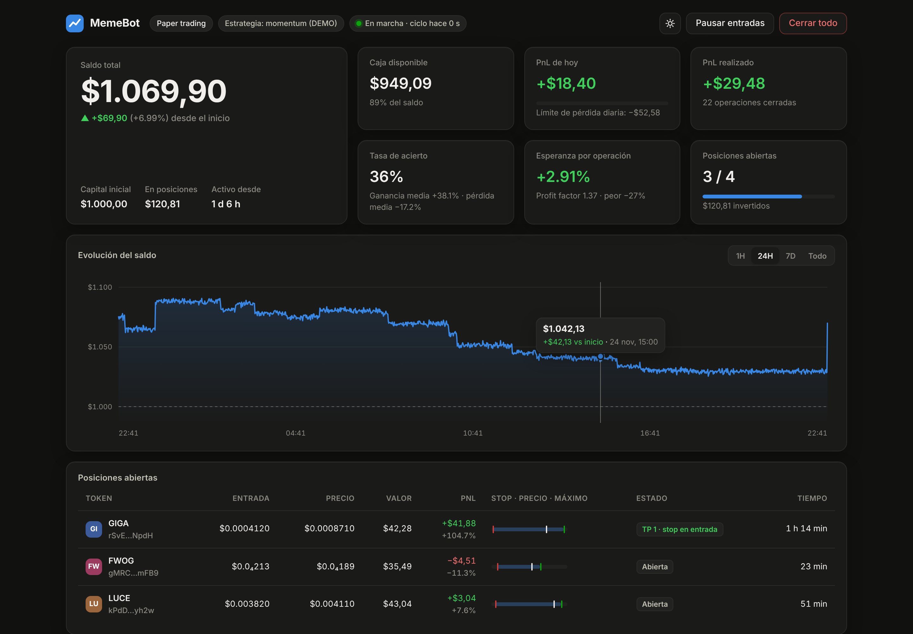

# MemeBot — bot de trading de memecoins en Solana

> **Aviso honesto.** La mayoría de las memecoins van a cero en horas, y la mayoría de quienes las tradean pierden
> dinero. Tus rivales son snipers con infraestructura dedicada, insiders y bots MEV. Este proyecto no promete
> beneficios. Lo que sí hace es **medir** qué funciona antes de arriesgar dinero, con datos reales y sin
> autoengaños, y aplicar una gestión de riesgo que limita cuánto puedes perder. Usa solo dinero que puedas
> perder entero.

**¿Empiezas con poco dinero? → [GUIA_50EUR.md](GUIA_50EUR.md)** (cómo funciona, dónde depositar, qué wallet y cómo pasar a real).

**Cerebro autónomo:** `bot/brain.py` aprende de las velas y de sus propias operaciones, hace competir estrategias en
datos no vistos y cambia la del bot solo si demuestra ventaja. Nunca toca el riesgo. Ver la sección *Cerebro* del panel.




---

## 1. Las estrategias que existen y qué dicen los datos

| Estrategia | Idea | Quién gana | Veredicto |
|---|---|---|---|
| **Sniping** (bloque 0 en pump.fun) | Comprar en el lanzamiento | Equipos con nodos propios, bundles de Jito e insiders, que a menudo ya compraron el supply con decenas de wallets | ❌ No competible para un particular |
| **Early** (primeros 3–30 min) | Subirse si arranca fuerte | Quien llega primero | Medida en el backtest (estrategia `early`) |
| **Copy trading** | Copiar "smart wallets" | El copiado. Hay bots que cazan a los copy-traders (arXiv 2601.08641) | ⚠️ Solo como señal de confirmación |
| **Momentum de segunda ola** | Token asentado + volumen acelerando + subida no parabólica | Quien filtra y corta rápido | Medida (`momentum`) |
| **Breakout** | Ruptura del máximo de 3 h con volumen | Igual | Medida (`breakout`) |
| **Dip / reversión** | Caída fuerte desde máximos + primer rebote | Quien tiene disciplina de stops | Medida (`dip`) |
| **Baseline** | Entrar en cualquier momento con actividad | — | Referencia: **si una estrategia no bate esto, su "ventaja" es ruido** |

### Lo que aprendimos de los datos (y por qué muchos bots se autoengañan)
1. **La mayoría de los tokens viven entre 1 y 4 horas.** Las ventanas útiles son cortas, así que los time stops y
   los take-profits rápidos importan más que los objetivos de x10.
2. **Sesgo de selección.** Si backtesteas los tokens que están "en tendencia" hoy, estás mirando tokens que acaban de
   subir, y cualquier estrategia de momentum parece una máquina de dinero. Por eso este proyecto **solo cuenta
   operaciones posteriores al momento en que el token entró en la muestra** (`selected_at`), y además muestrea
   lanzamientos al azar antes de saber cómo acaban.
3. **Datos corruptos.** Las pools sin liquidez generan velas con precios ×20–×60. Sin limpiarlas, el backtest se
   inventa ganancias de miles de %. Se eliminan los picos aislados hacia arriba; los de abajo se dejan, porque solo
   hacen el resultado más pesimista.
4. **Costes reales.** Cada lado paga fee, slippage/MEV e impacto. Con posiciones pequeñas en pools finas, eso suma un
   2–3 % por operación ida y vuelta: una estrategia que "gana un 2 %" en realidad pierde.

---

## 2. Arquitectura

```
research/collect.py ──► data/ (velas de 1 min, a futuro) ──┐
research/sample_launches.py ──► data_launches/ ─────────────┤
                                                             ▼
                                          research/backtest.py  (5 estrategias × cientos de combinaciones,
                                                             │      in-sample / out-of-sample, costes reales)
                                                             ▼
                                          research/apply_best.py ──► config.paper.yaml
                                                             │
                     ┌───────────────────────────────────────┘
                     ▼
bot/main.py  cada 20 s: salidas  ·  cada 60 s: entradas
  1. descubrimiento: DexScreener (perfiles/boosts) + GeckoTerminal (trending / más activos)
  2. prefiltro en tiempo real: liquidez, DEX, edad, volumen, FDV            (bot/strategy.py)
  3. velas de 1 min → MISMA señal que el backtest                           (bot/signals.py)
  4. anti-rug: mint/freeze revocadas, top-10 holders, RugCheck, ruta de venta (bot/safety.py)
  5. tamaño por riesgo fijo + kill-switch diario                            (bot/risk.py)
  6. ejecución: paper con cotizaciones reales de Jupiter, o swaps reales Jupiter v2 (bot/executor.py)
  7. registro: state/trades.csv, state/decisions.jsonl, Telegram
```

**Salidas** (por orden de prioridad):
- **Liquidez −40 %:** se vende todo (posible rug).
- **Stop loss:** salida total. Tras el primer take-profit, el stop sube al precio de entrada.
- **Trailing stop:** desde el máximo alcanzado.
- **Time stop:** si en N minutos no ha subido lo mínimo, se sale.
- **Take-profits escalonados.**

Todos los valores salen del backtest.

### Panel en tiempo real
```bash
python -m bot.dashboard --state state          # abre http://127.0.0.1:8050
```
- **Saldo total**, con la variación desde el inicio y la curva de saldo (1H / 24H / 7D / Todo, con cursor).
- **Indicadores:** caja disponible, PnL de hoy (con el consumo del límite diario), PnL realizado, tasa de acierto,
  esperanza por operación y posiciones abiertas.
- **Posiciones abiertas** con PnL en vivo y una barra que sitúa el stop, el precio actual y el máximo.
- **Historial:** operaciones cerradas con su motivo de salida, y ejecuciones con enlace a Solscan en modo real.
- **Escáner:** el embudo de candidatos y la actividad del bot.
- **Botones Pausar entradas y Cerrar todo:** el bot los ejecuta en su siguiente ciclo, en 20 s como máximo.
- **Aviso** si el bot deja de responder.

El panel es de solo lectura, salvo esos dos botones. Por defecto solo escucha en tu máquina. En un VPS, ábrelo
con un túnel: `ssh -L 8050:127.0.0.1:8050 usuario@vps`. Si lo expones de otra forma, `DASHBOARD_TOKEN` es
obligatorio. Para verlo con datos de ejemplo: `python -m research.demo_state --out state-demo` y
`python -m bot.dashboard --state state-demo`.

---

## 3. Puesta en marcha

### Paso 1 — Instalar
```bash
cd memebot
python3 -m venv .venv && source .venv/bin/activate
pip install -r requirements.txt
cp .env.example .env            # rellenar después
python -m pytest -q             # deben pasar todos los tests
```

### Paso 2 — Recoger datos (déjalo corriendo 24/7; cuanto más tiempo, mejor)
```bash
python -m research.collect --loop 15                          # universo activo, datos a futuro
python -m research.sample_launches --minutes 60 --every 180   # lanzamientos al azar…
python -m research.sample_launches --fetch --loop 30          # …y sus velas
python -m research.lifecycle --data data                      # estadísticas de vida de los tokens
```
O todo con Docker: `docker compose up -d collector launches`.

### Paso 3 — Backtest y elección de estrategia
```bash
python -m research.backtest --data data,data_launches --out reports
python -m research.apply_best --report reports/backtest.json --out config.paper.yaml
```
`apply_best` **se niega** a generar una configuración si ninguna estrategia es positiva tanto in-sample como
out-of-sample. Repite el backtest cada semana, con más datos.

### Paso 4 — Paper trading (mínimo 2–4 semanas y 50 operaciones)
```bash
python -m bot.preflight --config config.paper.yaml
python -m bot.main --config config.paper.yaml
python -m bot.dashboard --state state                  # panel en http://127.0.0.1:8050
python -m research.report --state state                # informe en texto
```
En paper, las compras y ventas se valoran con **cotizaciones reales de Jupiter** (ruta e impacto auténticos), con un
0,5 % de margen extra en contra. Compara el informe con el backtest: si el paper rinde mucho peor, el backtest era
optimista.

### Paso 5 — Preparar el dinero real
1. **RPC privado** gratuito (Helius o QuickNode) → `SOLANA_RPC_URL`.
2. **Wallet nuevo**, solo para el bot (Phantom o Solflare). Deposita el capital en **USDC** más ~0,1 SOL para
   comisiones. Exporta la clave privada (base58) a `WALLET_PRIVATE_KEY`. **Nunca** uses tu wallet principal y
   nunca compartas `.env`.
3. **Clave de Jupiter** gratuita en portal.jup.ag → `JUPITER_API_KEY`.
4. **Telegram** (opcional): crea un bot con @BotFather → `TELEGRAM_BOT_TOKEN`; tu chat id → `TELEGRAM_CHAT_ID`.

### Paso 6 — Live, empezando pequeño
```bash
cp config.paper.yaml config.live.yaml
# en config.live.yaml:  mode: live   y   risk.starting_equity_usd: 100   (sube solo con meses de datos reales)
python -m bot.preflight --config config.live.yaml      # comprueba wallet, saldo, Jupiter, historial de paper
python -m bot.main --config config.live.yaml
```
Si no has hecho paper, o este tiene esperanza negativa, preflight te lo advierte. Hazle caso.

### Paso 7 — 24/7 en un VPS (Hetzner o DigitalOcean, ~5 €/mes, en EE. UU. o Frankfurt)
```bash
# alternativa sin Docker (solo el bot, con systemd): bash deploy/install_vps.sh
sudo bash deploy/install.sh                  # recomendado: Docker con los 5 servicios, 24/7 y autorreinicio
```

---

## 4. Seguridad, riesgo y legal
- Las salidas protegen frente a caídas graduales, **no frente a un rug instantáneo**: tu verdadera protección es el
  tamaño pequeño por operación (≈1 % del capital en riesgo) y el kill-switch diario (−5 %).
- El bot solo usa el presupuesto `starting_equity_usd`, no el saldo total del wallet.
- No instales "bots de Telegram" que pidan tu clave privada: es el timo más común del sector.
- **Impuestos (España):** cada swap es una ganancia o pérdida patrimonial (IRPF, base del ahorro). `state/trades.csv`
  es tu registro; consulta a un asesor fiscal.
